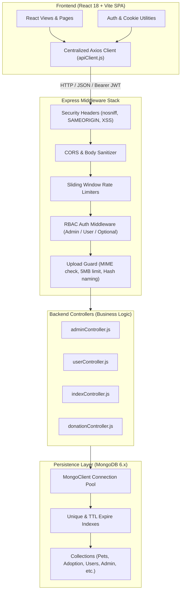

# 🐾 Adopet — Full-Stack Pet Adoption & Welfare Platform

[](https://nodejs.org/)
[](https://react.dev/)
[](https://expressjs.com/)
[](https://www.mongodb.com/)
[](https://vitejs.dev/)
[](./api/test_audit.js)

**Adopet** (also branded as *Woof! Pet Adoption*) is a production-grade, enterprise-hardened full-stack MERN application engineered to streamline pet adoptions, homeless rescue reporting, shelter inventory management, and welfare donations.

The application adheres to modern architectural standards featuring decoupled client-server architecture, strict Role-Based Access Control (RBAC), cryptographic password hashing, sliding-window rate limiting, NoSQL injection defenses, and atomic state synchronization between adoptions and pet availability.

---

## 📑 Table of Contents

- [System Architecture](#-system-architecture)
- [Key Features](#-key-features)
- [Tech Stack](#-tech-stack)
- [Security & Resilience Matrix](#-security--resilience-matrix)
- [Repository & Directory Structure](#-repository--directory-structure)
- [Database Schema & Collections](#-database-schema--collections)
- [REST API Reference](#-rest-api-reference)
- [Getting Started & Installation](#-getting-started--installation)
- [Environment Configuration](#-environment-configuration)
- [Automated Testing & Security Verification](#-automated-testing--security-verification)
- [Production Deployment Guidelines](#-production-deployment-guidelines)
- [Contributing & License](#-contributing--license)

---

## 🏗️ System Architecture

Adopet implements a decoupled **Client-Service-Controller-Database** architecture:



### Request / Response Flow
1. **Client Action**: The user interacts with React Hook Form forms or navigation hooks.
2. **API Client**: `apiClient.js` injects the correct Bearer JWT from secure cookies based on context.
3. **Defense Layer**: Request passes through rate limiting, prototype-pollution sanitization, and strict RBAC verification.
4. **Controller Execution**: Parameterized and validated inputs are processed; passwords use cryptographic salt + scrypt.
5. **Persistence**: Queries execute with safe `ObjectId` validation; expired OTPs are automatically purged via MongoDB TTL indexes.
6. **Standardized Response**: Emits uniform `{ success, message, data }` responses with accurate HTTP status codes (`200`, `201`, `400`, `401`, `403`, `404`, `429`, `500`).

---

## ✨ Key Features

### 🌐 Public & Guest Portal
- **Pet Discovery Showcase**: Filterable gallery of pets with age, breed, gender, vaccination, and friendliness tags.
- **Organization Profile & Team**: Meet our leadership and adoption caregivers (with automated credential redaction).
- **Public Contact Form**: Direct inquiry form protected by rate limiters and payload sanitization.
- **Online Welfare Donations**: Mock/Razorpay-ready donation interface supporting predefined tiers (₹50 - ₹5,000) and custom contributions.

### 👤 User / Adopter Dashboard
- **Authentication Lifecycle**: Secure sign-up, sign-in, and 6-digit email OTP password recovery.
- **Adoption Applications**: Multi-field adoption request submission (residence, family structure, pet experience).
- **Application Status Tracking**: Live status monitor for applications (`Pending`, `Confirmed`, `Cancelled`).
- **Pet Feedback System**: Submit post-adoption testimonials and welfare updates.
- **Rescue / Homeless Pet Reporting**: Report lost or injured street animals with location coordinates and photo description.

### 🛡️ Admin Management Console
- **Analytics Dashboard**: High-level telemetry covering active pets, pending adoptions, and community feedbacks.
- **Pet Catalog Management**:
  - Add, edit, and soft/hard delete pets.
  - Multi-tiered category and breed management with cascade deletion protection.
  - Single and multi-photo gallery uploads with strict MIME inspection and unique file hashing.
- **Adoption Request Processing**:
  - Review candidate suitability.
  - One-click **Confirm / Cancel** triggers automatic inventory state synchronization (`isAvailable: 'Adopted'` vs `'yes'`).
- **User & Homeless Pet Oversight**:
  - Audit registered adopters (passwords completely scrubbed).
  - Review street animal rescue reports and manage administrative team accounts.

---

## 💻 Tech Stack

| Layer | Technologies | Purpose |
|---|---|---|
| **Frontend** | React 18, Vite 5, React Router v6 | Single Page Application, dynamic routing, code splitting |
| **UI Components** | Bootstrap 5, React-Bootstrap, React Icons | SaaS responsive layout, cards, off-canvas drawers, modals |
| **Forms & State** | React Hook Form, React Toastify | High-performance forms, instant client validation, notifications |
| **HTTP Client** | Axios (with Request/Response Interceptors) | Centralized Bearer token handling and 401 session recovery |
| **Backend** | Node.js, Express.js 4.21 | RESTful API server, middleware pipeline |
| **Database** | MongoDB 6.9 Native Driver | Native connection pooling, aggregation pipelines, TTL indexes |
| **Security** | Node Native `crypto`, JWT (`jsonwebtoken`) | Salted scrypt key derivation, HS256 stateless tokens |
| **Traffic & Uploads** | Sliding-window limiter, `express-fileupload` | Anti-brute force, anti-DoS, safe media processing |
| **Email Service** | Nodemailer (Gmail SMTP + Dev Simulator) | Real-time OTP dispatch with simulated dev fallbacks |

---

## 🔒 Security & Resilience Matrix

Adopet underwent a rigorous security audit and penetration test suite covering 23 attack vectors. All vulnerabilities were closed:

| Vector | Security Threat | Defensive Implementation |
|---|---|---|
| **Data Leakage** | `GET /get-ourteam` dumping admin passwords | MongoDB inclusion projection strictly whitelisting only public name and role. |
| **Privilege Escalation** | Regular user tokens executing admin endpoints | `adminAuthMiddleware` verifies `decoded.role === 'admin'`; returns `403 Forbidden` on role mismatch. |
| **OTP Authentication Bypass** | Direct password resets without OTP validation | Signed short-lived `resetToken` or verified DB OTP state required before resetting password. |
| **Plaintext Credentials** | Raw passwords stored in database | Salted `crypto.scrypt` password hashing. Automatic legacy plaintext upgrade on next login. |
| **NoSQL Injection / BSON Crash** | Malformed ObjectIds causing uncaught crashes | `toObjectId()` validation utility returns `400 Bad Request` instead of crashing. |
| **Arbitrary File Upload** | Attacker uploading `.php` / `.html` or path traversal | MIME type verification (`image/*`), safe random filename generation, and 5MB size ceiling. |
| **Brute Force & Spam** | Infinite login attempts and OTP flooding | Sliding-window rate limiters on auth (15/min), OTP (5/5min), and contact endpoints. |
| **Client Session Recovery** | Expired tokens leaving UI in frozen state | Axios response interceptor intercepts `401`, clears stale cookies, and smoothly redirects to login. |

---

## 📂 Repository & Directory Structure

```text
Pet_Adoption/
├── api/                                # Backend Server (Node.js + Express)
│   ├── config/
│   │   └── connection.js               # MongoDB connection pool & index setup
│   ├── controllers/
│   │   ├── adminController.js          # Admin catalog, requests, feedback logic
│   │   ├── userControlller.js          # User auth, adoption, profile logic
│   │   ├── indexController.js          # Public routes, team, contact
│   │   └── donationController.js       # Razorpay donation workflows
│   ├── middlewares/
│   │   ├── AuthMiddleware.js           # RBAC token guards (Admin / User / Optional)
│   │   ├── errorHandler.js             # Global centralized error handler
│   │   ├── rateLimiter.js              # Sliding window rate limiters
│   │   └── securityHeaders.js          # Defensive HTTP headers & prototype sanitizer
│   ├── public/
│   │   └── images/                     # User-uploaded pet and gallery photos
│   ├── utils/
│   │   ├── crypto.js                   # Scrypt hashing, OTP, reset tokens
│   │   ├── env.js                      # Zero-dependency .env parser
│   │   ├── mailer.js                   # Nodemailer transporter + dev simulator
│   │   ├── objectId.js                 # Safe ObjectId validation helpers
│   │   └── response.js                 # Standardized JSON response emitter
│   ├── .env                            # Server environment variables
│   ├── .env.example                    # Environment variable template
│   ├── app.js                          # Express entry point & route registration
│   ├── package.json                    # API dependencies & test scripts
│   └── test_audit.js                   # 23-point automated penetration test suite
│
├── client/                             # Frontend Client (React 18 + Vite)
│   ├── public/                         # Static assets (favicons, template vendor scripts)
│   ├── src/
│   │   ├── assets/                     # SVG icons and custom styles
│   │   ├── components/                 # Reusable UI widgets
│   │   │   ├── AdminNavbar.jsx         # Admin navigation bar
│   │   │   ├── UserNavbar.jsx          # User navigation bar
│   │   │   ├── Navbar.jsx              # Public navigation bar
│   │   │   ├── Footer.jsx              # Global footer
│   │   │   └── AdoptionForm.jsx        # Reusable adoption input form
│   │   ├── layouts/                    # Role-specific master wrappers
│   │   │   ├── AdminLayout.jsx         # Guarded Admin master layout
│   │   │   ├── UserLayout.jsx          # Guarded User master layout
│   │   │   └── PublicLayout.jsx        # Public guest master layout
│   │   ├── pages/
│   │   │   ├── admin/                  # Admin dashboard & management views
│   │   │   ├── user/                   # Adopter dashboard, adoption, donation views
│   │   │   ├── Home.jsx                # Landing page
│   │   │   ├── MainAbout.jsx           # About Us view
│   │   │   └── MainContact.jsx         # Contact Us view
│   │   ├── services/
│   │   │   └── apiClient.js            # Centralized Axios client with interceptors
│   │   ├── utils/
│   │   │   ├── config.js               # Dynamic backend URL resolver
│   │   │   └── module.js               # Cookie & token utility helpers
│   │   ├── App.jsx                     # Route registry with lazy suspense
│   │   ├── main.jsx                    # Vite React root
│   │   └── index.css                   # Global styling
│   ├── eslint.config.js                # ESLint configuration
│   ├── package.json                    # Frontend dependencies
│   └── vite.config.js                  # Vite configuration
│
├── __skills__/                         # Architectural blueprints & design patterns
└── README.md                           # Master Project Documentation
```

---

## 🗄️ Database Schema & Collections

| Collection | Key Fields | Descriptions & Relationships |
|---|---|---|
| `Admin` | `_id`, `fullName`, `email` *(unique)*, `password` *(scrypt hash)*, `role: 'admin'`, `createdAt` | Administrative staff credentials with system-wide privileges. |
| `User` | `_id`, `fullName`, `email` *(unique)*, `password` *(scrypt hash)*, `mobile`, `address`, `role: 'user'` | Public adopter accounts. |
| `Category` | `_id`, `categoryName` *(case-insensitive unique)*, `createdAt` | High-level pet species (e.g., Dog, Cat, Bird). |
| `SubCategory` | `_id`, `subcategory`, `categoryId` *(FK -> Category._id)*, `subcategoryDescription` | Specific pet breeds linked to a parent category. |
| `Pets` | `_id`, `petName`, `petType` *(FK)*, `petBreed` *(FK)*, `petPhoto`, `isAvailable` *(yes/Adopted)* | Pet inventory records. Availability auto-syncs with adoption outcomes. |
| `PetsGallery` | `_id`, `petId` *(FK -> Pets._id)*, `petPhotoGallery`, `createdAt` | Additional photo albums associated with a pet profile. |
| `Adoption` | `_id`, `userId` *(FK)*, `petId` *(FK)*, `adoptionStatus` *(Pending/Confirmed/Cancelled)* | Adoption applications submitted by adopters. |
| `Feedback` | `_id`, `userId` *(FK)*, `petId` *(FK)*, `feedback`, `createdAt` | Testimonials and pet welfare reviews. |
| `HomelessPets` | `_id`, `petType`, `petColor`, `location`, `description`, `reportedBy` | Community reports of street animals needing rescue. |
| `Donations` | `_id`, `orderId`, `amount`, `currency`, `donorName`, `donorEmail`, `status` | Financial contributions and transaction logs. |
| `OTP` | `_id`, `email`, `role`, `otp`, `expiresAt` *(TTL index)*, `verified` | Ephemeral verification codes automatically purged upon expiry. |

---

## 📡 REST API Reference

All successful responses return HTTP `200` or `201` with:
```json
{
  "success": true,
  "error": false,
  "message": "Human readable confirmation",
  "data": { ... }
}
```
All client or server errors return appropriate HTTP `4xx` or `5xx` with:
```json
{
  "success": false,
  "error": true,
  "message": "Specific error description"
}
```

### 1. Public & Guest APIs
| Method | Endpoint | Description | Auth Required |
|---|---|---|---|
| `GET` | `/get-ourteam` | Fetch team member details (passwords/emails redacted) | None |
| `POST` | `/contact-us` | Submit public contact message *(Rate-limited)* | None |
| `GET` | `/api/health` | Service uptime and health telemetry | None |

### 2. Authentication & Password Lifecycle
| Method | Endpoint | Description | Auth Required |
|---|---|---|---|
| `POST` | `/user-signin` | Adopter login → Returns JWT (`role: 'user'`) | None |
| `POST` | `/user-registration` | Create adopter account with salted scrypt hash | None |
| `POST` | `/user-forgetpassword` | Dispatch 6-digit verification code to email | None |
| `POST` | `/user-verify-otp` | Verify OTP → Returns short-lived `resetToken` | None |
| `POST` | `/user-reset-password` | Set new password using verified `resetToken` | None |
| `POST` | `/user-changepassword` | Update password while logged in | User |
| `POST` | `/admin-signin` | Admin login → Returns JWT (`role: 'admin'`) | None |
| `POST` | `/admin-forgetpassword`| Dispatch admin password reset code | None |
| `POST` | `/admin-verify-otp` | Verify admin OTP → Returns `resetToken` | None |
| `POST` | `/admin-reset-password`| Reset admin password with verified token | None |
| `POST` | `/admin-changepassword`| Update admin password while logged in | Admin |

### 3. Pet Catalog & Adoption Workflow
| Method | Endpoint | Description | Auth Required |
|---|---|---|---|
| `GET` | `/manage-pets` | List all available pets with breed & species details | Optional / User / Admin |
| `GET` | `/pets/:petId` | Retrieve full profile of a single pet | Optional / User / Admin |
| `GET` | `/manage-subcategory/:id` | Cascade fetch subcategories for a given category | Optional / User / Admin |
| `POST` | `/mainAdoption-pet` | Submit an adoption application for a pet | User |
| `GET` | `/adoption-pets-request` | List personal adoption requests for logged-in user | User |
| `POST` | `/manage-pets` | Register new pet in catalog | Admin |
| `DELETE`| `/manage-pets/:id` | Delete pet and purge associated gallery photos | Admin |
| `POST` | `/manage-pet-photo` | Upload primary pet photo (MIME verified, 5MB cap) | Admin |
| `POST` | `/manage-pet-photoGallery` | Add photo to pet gallery album | Admin |
| `GET` | `/adoption-pets` | List all submitted adoption requests | Admin |
| `PUT` | `/adoption-pets/:id` | Review request (`Confirmed`/`Cancelled`/`Pending`) | Admin |
| `DELETE`| `/adoption-pets/:id` | Remove an adoption request record | Admin |

### 4. Category & Administrative Management
| Method | Endpoint | Description | Auth Required |
|---|---|---|---|
| `POST` | `/manage-category` | Create new pet species category | Admin |
| `GET` | `/manage-category` | List all species categories | Admin |
| `DELETE`| `/manage-category/:id` | Delete category *(Blocked if pets/breeds are linked)* | Admin |
| `POST` | `/manage-subcategory` | Add breed under parent category | Admin |
| `GET` | `/manage-subcategory` | List breeds with parent category resolution | Admin |
| `DELETE`| `/manage-subcategory/:id`| Delete breed *(Blocked if pets are assigned)* | Admin |
| `POST` | `/admin-registration` | Create secondary admin account | Admin |
| `GET` | `/admin-registration` | List admin accounts (passwords scrubbed) | Admin |
| `DELETE`| `/admin-registration/:id`| Delete admin *(Protected against self/last deletion)* | Admin |
| `GET` | `/view-users` | Audit all registered adopter profiles | Admin |
| `DELETE`| `/view-users/:id` | Delete user account | Admin |

### 5. Community, Feedback & Welfare Donations
| Method | Endpoint | Description | Auth Required |
|---|---|---|---|
| `POST` | `/feedback` | Submit adopter feedback for a pet | User |
| `GET` | `/fetch-feedbacks` | Fetch aggregated feedbacks with pet and user info | Admin |
| `POST` | `/reportfound-pet` | Report street / homeless animal | User / Public |
| `GET` | `/getHomelessPets-data` | Retrieve rescue reports | Admin |
| `DELETE`| `/getHomelessPets-data/:id` | Dismiss or resolve a rescue report | Admin |
| `POST` | `/create-donation` | Initialize donation order | Optional / User |
| `POST` | `/verify-donation` | Record and verify donation contribution | Optional / User |

---

## 🚀 Getting Started & Installation

### Prerequisites
- [Node.js](https://nodejs.org/) v18.0.0 or higher
- [MongoDB](https://www.mongodb.com/try/download/community) server running locally on `localhost:27017` (or MongoDB Atlas cluster URI)
- Git

### 1. Clone the Repository
```bash
git clone https://github.com/your-username/Pet_Adoption.git
cd Pet_Adoption
```

### 2. Backend Setup
```bash
cd api

# Install backend dependencies
npm install

# Verify or configure environment variables
# (A ready-to-run .env is pre-configured; see .env.example for overrides)

# Start backend server
npm run dev
```
The backend API will start on **http://localhost:5000**.

### 3. Frontend Setup
Open a new terminal window:
```bash
cd client

# Install frontend dependencies
npm install

# Start Vite development server
npm run dev
```
The frontend UI will be available at **http://localhost:5173**.

---

## ⚙️ Environment Configuration

Backend configuration is loaded from [api/.env](file:///D:/__VMM__/___Student%20Projects___/MERN/Pet_Adoption/api/.env):

```env
# Application Port
PORT=5000

# Database Configuration
MONGO_URI=mongodb://localhost:27017
DB_NAME=Adopet

# Security Credentials
JWT_SECRET=super_secure_production_secret_key_pet_adoption_2026_!@#$%^

# Client URL (for CORS whitelisting)
CLIENT_URL=http://localhost:5173

# Email Service (Nodemailer Gmail SMTP)
EMAIL_USER=your_email@gmail.com
EMAIL_PASS=your_email_app_password

# Environment Mode (development / production / test)
NODE_ENV=development
```

Frontend configuration can be provided via `client/.env`:
```env
VITE_API_BASE_URL=http://localhost:5000/
VITE_RAZORPAY_KEY_ID=rzp_test_your_key_id
```

---

## 🧪 Automated Testing & Security Verification

The backend includes a comprehensive, standalone penetration and regression test suite covering:
1. Cryptographic password hashing & salted scrypt key derivation.
2. Legacy password automatic upgrade mechanics.
3. NoSQL / BSON injection crash resistance.
4. Redaction of sensitive credentials on public endpoints.
5. Privilege escalation defenses (verifying `role: 'user'` cannot execute admin endpoints).
6. Unauthenticated OTP password reset bypass defense.
7. Security response headers (`nosniff`, `SAMEORIGIN`, `X-XSS-Protection`).
8. Donation order creation and verification flow.
9. File upload security against malicious extensions and path traversal attacks.
10. Multi-field input validation and user adoption query execution.

### Running the Test Suite
```bash
cd api
npm test
```

**Expected Test Output**:
```text
====================================================
🛡️  STARTING PRODUCTION-GRADE AUDIT & PENETRATION SUITE
====================================================
--- TEST 1: Cryptographic Password Security ---
✅ [PASS] Hash uses secure scrypt with salt
✅ [PASS] Password is never stored in plain text
✅ [PASS] comparePassword verifies correct password
✅ [PASS] comparePassword rejects incorrect password

--- TEST 2: NoSQL / ObjectId Injection & Crash Resistance ---
✅ [PASS] isValidObjectId rejects invalid string
✅ [PASS] isValidObjectId accepts valid 24-hex string
✅ [PASS] toObjectId safely returns null on malformed input
✅ [PASS] Invalid pet ID returns 400 Bad Request without server crash

--- TEST 3: Sensitive Credential Exposure Defense ---
✅ [PASS] Public /get-ourteam endpoint responds 200 OK
✅ [PASS] Admin passwords, emails, and phone numbers are completely redacted from public endpoint

--- TEST 4: Privilege Escalation Defense (User -> Admin) ---
✅ [PASS] Normal user token CANNOT perform admin actions (403 Forbidden)

--- TEST 5: Unauthorized Access Defense ---
✅ [PASS] Request with missing token is rejected with 401 Unauthorized
✅ [PASS] Malformed authorization header is rejected with 401 Unauthorized

--- TEST 6: Password Reset Security (OTP Bypass Defense) ---
✅ [PASS] Direct password reset without verified OTP is blocked with 403 Forbidden

--- TEST 7: Security Response Headers ---
✅ [PASS] X-Content-Type-Options: nosniff header present
✅ [PASS] X-Frame-Options: SAMEORIGIN header present
✅ [PASS] X-XSS-Protection header present

--- TEST 8: Donation System Endpoints ---
✅ [PASS] Donation creation succeeds with 201 Created
✅ [PASS] Donation order ID generated
✅ [PASS] Donation verification succeeds with 200 OK

--- TEST 9: Contact Form Input Validation ---
✅ [PASS] Invalid contact submission rejected with 400 Bad Request

--- TEST 10: File Upload Security & Path Traversal Defense ---
✅ [PASS] Malicious file upload (.php/path traversal) is strictly rejected with 400 Bad Request

--- TEST 11: User Adoption Requests Bug Fix Verification ---
✅ [PASS] UserPendingRequestData successfully queries with user ID (no ObjectId casting crash)

====================================================
📊 AUDIT RESULTS: 23 PASSED, 0 FAILED
====================================================
```

### Running Frontend Linter and Production Build
```bash
cd client
npx eslint src --quiet   # 0 errors
npm run build           # Compiles Vite production bundle
```

---

## 🚢 Production Deployment Guidelines

1. **Environment Variables**:
   - Set `NODE_ENV=production`.
   - Use a high-entropy string for `JWT_SECRET` (at least 64 characters).
   - Use a dedicated MongoDB Atlas cluster with TLS enabled (`mongodb+srv://...`).
2. **Reverse Proxy & SSL**:
   - Deploy behind Nginx or Cloudflare with HTTPS/TLS enforcement.
   - Configure Nginx proxy buffering and client body limit (`client_max_body_size 10M;`).
3. **Static File Serving & CDN**:
   - The production Vite build can be generated via `npm run build` and served via Nginx or CDN (Vercel, Netlify, AWS S3/CloudFront).
   - Offload the `api/public/images` folder to an S3 bucket or Cloudinary in large-scale multi-instance setups.
4. **Process Management**:
   - Run the Node.js backend using PM2 with cluster mode:
     ```bash
     pm2 start app.js -i max --name "adopet-api"
     ```

---

## 📄 License & Contributing

Contributions are welcome! Please submit an issue or pull request for any suggested enhancements.

This project is licensed under the **ISC License**.

